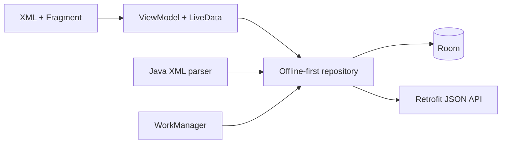

# Field Ops Android

An enterprise-style field-service application demonstrating Android SDK fundamentals, offline data, background synchronization, and Kotlin/Java interoperability.

## Highlights

- Kotlin application, repository, ViewModel, Room, Retrofit, and WorkManager layers
- Java RecyclerView adapter and Java XML parser
- XML layouts, AppCompat Activity, Fragment, View Binding, and Material components
- LiveData-based screen state for an enterprise Views codebase
- REST/JSON integration with a deterministic OkHttp demo backend
- Legacy XML work-order parsing example
- Room-backed offline queue and WorkManager retry behavior
- Unit-tested remote-to-local and local-to-domain mappings
- GitHub Actions verification

## Architecture



## Why this project is useful

Many enterprise Android products use a mix of modern Kotlin and established Java/XML components. This sample shows how to evolve that type of codebase without rewriting everything: data and asynchronous work use Kotlin and coroutines, while a Java adapter and parser interoperate with the same domain models.

## Demo backend

An OkHttp interceptor returns synthetic work orders, so the app can demonstrate Retrofit mapping without requiring a private server. Set `USE_DEMO_BACKEND` to `false` and update `API_BASE_URL` to connect a real service.

## Run

1. Open the project in Android Studio.
2. Use JDK 17 and install Android SDK 35.
3. Run the `app` configuration on an API 24+ emulator.

```bash
./gradlew testDebugUnitTest lintDebug
```

On Windows, use `gradlew.bat testDebugUnitTest lintDebug`.

## Interview discussion points

- When LiveData is appropriate in an XML/Fragment application
- How Java and Kotlin interoperate at generated getter and constructor boundaries
- Why the repository writes remote results into Room
- How the Java XML parser supports a legacy service beside a JSON API
- How WorkManager retries differ from interactive swipe-to-refresh
- How to replace `notifyDataSetChanged` with `ListAdapter` and `DiffUtil` in a follow-up improvement

## Scope

This is an original portfolio sample with synthetic work orders. It is not affiliated with Dell, Target, AMN Healthcare, Fiserv, or any other employer.

## License

MIT
